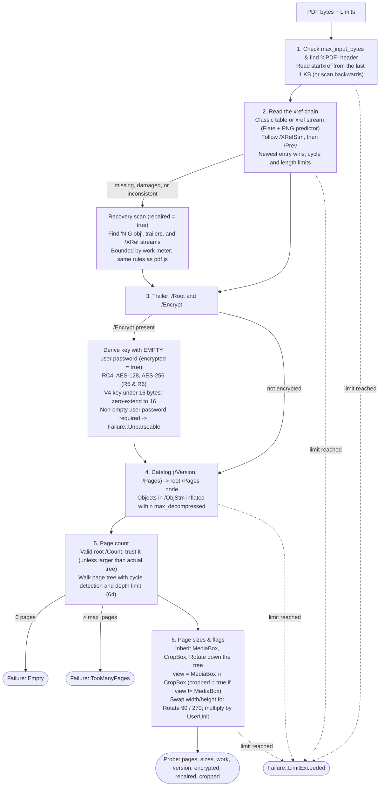

# How pdf-probe works

The library reads only what it needs: the header and tail of the file, the cross-reference data, the trailer, the encryption dictionary (if any), the catalog, the page tree, and the page dictionaries. It never touches content streams, fonts, or images, and never parses unreferenced objects unless the cross-reference is damaged and must be reconstructed.

## Core rules

- **Fail closed.** If a step cannot be completed with confidence, the result is `Failure::Unparseable`. If any resource limit (`max_input_bytes`, `max_work`, `max_objects`, `max_xref_sections`, `max_decompressed`) is reached, the result is `Failure::LimitExceeded` and no recovery rescan is attempted.
- **`/Count` handling.** Like `pdf.js` and poppler, `pdf-probe` trusts a valid non-negative integer `/Count` on the root `/Pages` dictionary and only walks the full tree beyond `/Count` when `/Count` is missing or invalid. If the tree has fewer pages than `/Count` claims, the actual lower count is returned.
- **Intended differences from `pdf.js`.** Listed in [`corpus/intended-differences.json`](../corpus/intended-differences.json): an empty page tree returns `Empty`, and Brotli-compressed streams or unparseable page objects fail closed rather than substituting a default page size.
