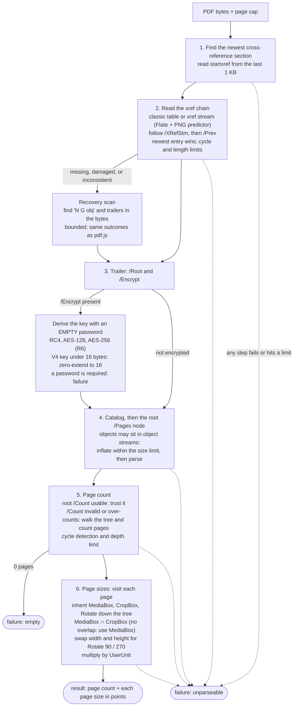

# How pdf-probe gets the page count and page sizes

> **This is the full design, and the code implements all of it.** Hardening is partly done: a mutation fuzzer has run about 28 million inputs without a panic, a hang or a memory spike, and a coverage-guided libFuzzer target exists but has not been run. Packaging and a measurement in a container are not done. Each step below is what the library must do to match pdf.js on the [corpus](../corpus/README.md); the rules come from pdf.js's behaviour, the PDF specification, and the findings in [`corpus/triage-pdfjs-samples.md`](../corpus/triage-pdfjs-samples.md). The recovery scan runs when no cross-reference section can be read, when the catalog or page tree root is not a dictionary, or when fetching the first or last page hits a bad entry, as in pdf.js.

The library reads only what it needs: the end of the file, the cross-reference data, the catalog, the page tree and the page dictionaries. It does not touch content streams, fonts or images, and it does not read every object in the file.

## Notes on the rules

- **Fail closed.** If a step cannot be completed with confidence, or a limit is reached (object count, recursion depth, cross-reference chain length, decompressed size), the result is a failure. The library never guesses a page count and never invents a page size for a page object it cannot parse.
- **`/Count`.** pdf.js trusts a valid `/Count` and counts the real pages only when `/Count` is invalid or larger than the tree. Gemini reads and bills exactly `/Count` pages, so an under-count is not a way past a page cap. See [`corpus/README.md`](../corpus/README.md).
- **Failure kinds.** `unparseable` (damaged, unsupported, password required, limit hit) and `empty` (well-formed, no pages). A wrapper with a fixed set of kinds maps `empty` to `unparseable`.
- **Where it differs from pdf.js.** Listed, with reasons, in [`corpus/intended-differences.json`](../corpus/intended-differences.json): an empty page tree is a failure, and a Brotli-compressed structure is a failure.
- **Not yet measured.** Memory and speed of the real library: nothing to measure until it exists.
